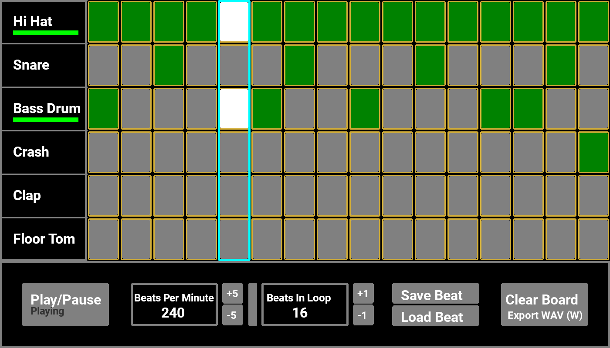
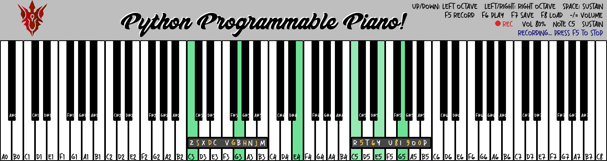
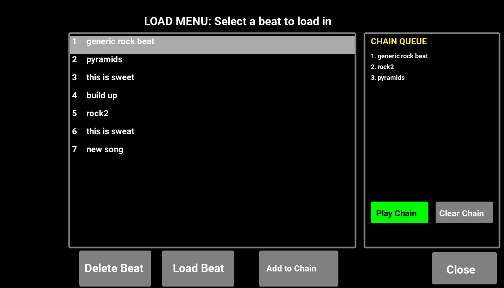
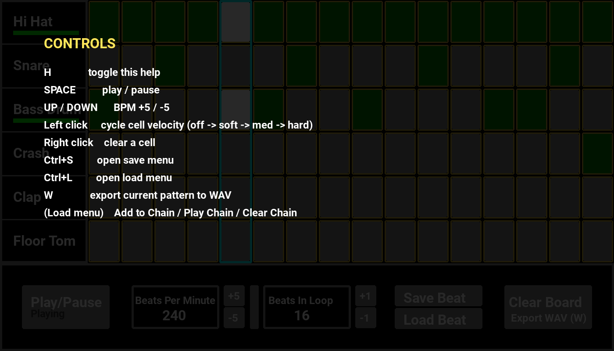

# 🥁🎹 Virtual Beat Maker

A CBSE Class 12 Computer Science practical project (2025–26) built with **Python** and **Pygame**. It contains two programs:

- **The Beat Maker** - a visual drum machine / step sequencer
- **Python Programmable Piano** - a playable 88-key piano

Each program has a **V1** (the first working version) and a **V2** (the upgraded version), so the improvements are easy to compare.

[](https://www.python.org/)
[](https://www.pygame.org/)

<p align="center">
  
  
</p>

---

## 📁 Project Structure

```
Virtual-Beat-Maker/
├── Cs Project_DrumKIt/
│   ├── mainV1.py          # Drum machine, version 1
│   └── mainV2.py          # Drum machine, version 2 (adds pattern chaining)
├── Cs project_Piano/
│   ├── mainV1.py          # Piano, version 1 (original)
│   ├── mainV2.py          # Piano, version 2 (upgraded)
│   └── Piano_List.py      # Note names and key layout used by the piano
├── sounds/                # Drum samples (.wav)
├── Notes/                 # 88 piano note samples (A0.wav ... C8.wav)
├── images/                # Screenshots used in this README
├── saved_beats.json       # Saved drum patterns (auto-generated)
├── Roboto-Bold.ttf, Angelos.ttf, Terserah.ttf, Transcity DEMO.otf   # Fonts
├── logo.png
└── README.md
```

---

## 🖥️ Requirements

- Python 3.8+
- `pygame` and `numpy`
- Recommended IDE: Visual Studio Code

```bash
pip install pygame numpy
```

## 🚀 How to Run

```bash
git clone https://github.com/DiptanshuGhosh/Virtual-Beat-Maker.git
cd Virtual-Beat-Maker

# Drum machine (run from the project root so it finds sounds/ and the fonts)
python "Cs Project_DrumKIt/mainV2.py"

# Piano
python "Cs project_Piano/mainV2.py"
```

> **Note:** the drum machine loads its sounds with Windows-style paths (`sounds\kick.wav`), so it is written for **Windows** and should be started from the project root folder. The piano V2 works on any OS.

---

## 🥁 The Beat Maker


**Features (V1 and V2)**

- 6-instrument kit: Hi Hat, Snare, Bass Drum, Crash, Clap, Floor Tom
- Step-sequencer grid with a moving playhead and per-hit flash animation
- Three hit strengths per cell (soft / medium / hard) via click-to-cycle velocity
- Adjustable BPM and loop length, optional swing, and a 4-beat count-in
- Mute / unmute each instrument, with a level meter under each label
- Save, load and delete named beats (stored in `saved_beats.json`)
- Export the current pattern as a WAV file
- Built-in help overlay (press **H**)

**What's new in V2**

- **Pattern chaining** - queue several saved beats, then play them back to back like a song (**Add to Chain / Play Chain / Clear Chain** in the Load menu)
- Export is simplified to **WAV only** (V1 also offered MP3, which needed `pydub` and `ffmpeg` installed)



**Drum controls**

| Action | How |
| --- | --- |
| Play / pause | **Space** or the Play/Pause button |
| Change BPM | **Up / Down** arrows (±5) or the BPM buttons |
| Cycle a cell's strength (off → soft → medium → hard) | Left-click the cell |
| Clear a cell | Right-click the cell |
| Save a beat | **Ctrl+S** or **Save Beat** |
| Load / delete a beat | **Ctrl+L** or **Load Beat** |
| Export to WAV | **W** or **Export WAV** |
| Help overlay | **H** |

Press **H** in the app to show the in-app controls overlay:



---

## 🎹 Python Programmable Piano


**What's new in V2 (compared to V1)**

- **All 88 keys fit on screen** (V1's keyboard was wider than its window)
- **Octaves 0–8 all work**, so A0, A#0, B0 and C8 are playable too. Notes that don't exist on a real piano are ignored instead of crashing V1
- **Hold and release** - a note rings while the key is held and fades out when released
- **Sustain pedal** on **Space**
- Keys stay lit while held; sustained notes stay dimly lit
- **Volume control** with `-` and `=`
- **Record, play back, save and load** a melody
- Works on Windows, Mac and Linux, with no repeated image loading and a cleaner `Piano` class

**Piano controls**

| Action | How |
| --- | --- |
| Play notes | Click the keys, or use the keyboard: **Z S X D C V G B H N J M** (left hand) and **R 5 T 6 Y U 8 I 9 O 0 P** (right hand) |
| Change left-hand octave | **Up / Down** arrows |
| Change right-hand octave | **Left / Right** arrows |
| Sustain | Hold **Space** |
| Volume | **-** / **=** |
| Record / stop | **F5** |
| Play / stop playback | **F6** |
| Save / load melody | **F7** / **F8** (`saved_melody.txt`) |

The grey strips on the keyboard show which computer key plays which note in each hand's current octave.

---

## 🧠 Concepts Demonstrated

- Event-driven programming and GUI development
- 2D grid data structures for state management
- Real-time audio with multiple simultaneous channels
- File I/O for saving and loading (JSON and text)
- Object-oriented design (classes for the drum machine and the piano)
- Timing and animation maths for a 60 FPS render loop

## 📋 Roadmap

- [ ] Play the piano over a drum loop in one program
- [ ] More drum kits / sound themes (a `kit2` sample set is already included)
- [ ] MIDI input for the piano
- [ ] Export piano recordings as audio
- [ ] Dark / light theme toggle

---

## 📚 Credits / References

- LeMaster Tech - "How to Program a Drum Kit in Python! Beat Making Code Tutorial!" (YouTube, May 2022)
- Stack Overflow - How does `collidepoint()` work in Pygame?
- GitHub community references

## 👤 Author

**Diptanshu Ghosh** - Computer Science Project (2025–26)
